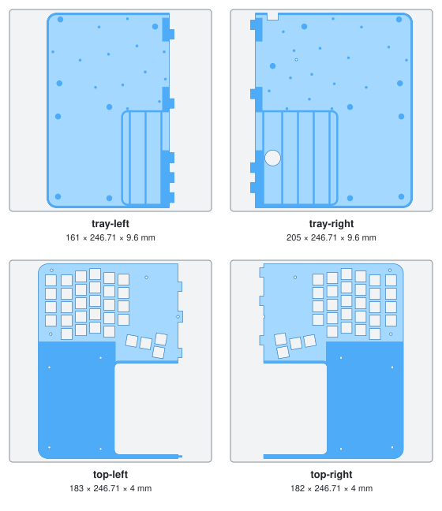

# Flatwell v1: order checklist

Everything needed to build one keyboard, in the order to buy it. All files are in
[`fab/macbook/`](fab/macbook/).

> **Status: untested prototype.** No board or case has been made yet. The PCB passes KiCad's
> design-rule check and the firmware compiles, but nothing has been checked against real parts.
> v1 may need a second revision.

## Step 0: check your switches (free)

This board only takes **Kailh Choc v1** low-profile switches (also sold as "PG1350").

| Yours look like | Fits? |
| --- | --- |
| Low, flat switch, about 11 mm tall in total. Stem has **two thin slots** side by side. Three pins: a fat center post and two thin metal legs. | Yes: Choc v1 |
| Tall switch with a **+ shaped** stem (Cherry MX, Gateron, Kinesis Advantage switches) | **No** |
| Low switch with a + shaped stem (Choc v2, Gateron low profile) | **No** |

You need **64**. If yours aren't Choc v1, add 70 Choc v1 switches to step 1 (any type: Red is
linear, Brown is tactile).

## Step 1: small parts (order first)

| Qty | Part | Exact item to search for | Notes |
| --- | --- | --- | --- |
| 1 | Controller | **nice!nano v2** (nicekeyboards.com; resellers: typeractive.xyz, splitkb.com) | Comes with pin headers. Not the "nice!nano v1", not a clone with a different pinout. |
| 70 | Hotswap sockets | **Kailh Choc hotswap socket, CPG135001S30** | Need 64. The Choc (low profile) kind, not the MX kind. |
| 60 | Keycaps, 1u | **MBK Choc keycaps, 1u** (or any Choc v1 keycap for 18 × 17 mm spacing) | 56 normal keys + 4 thumb. 8 of them sit on slightly wider (1.25u) outer-column spots. |
| 4 | Keycaps, 2u | **MBK Choc keycaps, 2u** | Tall thumb keys (Bksp, Del, Enter, Space), mounted vertically. |
| 1 | Battery | **3.7 V LiPo, 503450, 1000 mAh, JST-PH 2.0 mm 2-pin plug** | At most 6 mm thick, 40 × 60 mm. **Check polarity** before plugging in (see step 5). |
| 1 | Battery header | **JST S2B-PH-K-S** (JST-PH 2-pin, right-angle, through-hole) | |
| 1 | Power switch | **MSK-12C02** SMD slide switch (LCSC C128955) | Buy a few; they're tiny. |
| 1 | Reset button | **Alps SKQGABE010** SMD tactile switch (or any 5.2 × 5.2 mm 4-pad SMD tact switch) | Optional. |
| 64 | Diodes | **1N4148W, SOD-123** | Skip if PCBWay assembles them (step 3). |
| 20 | Threaded inserts | **M3 heat-set insert, brass, 4.6 mm outer diameter, 4–5.7 mm long** | Need 15. |
| 10 | Screws, long | **M3 × 8 mm button-head (ISO 7380)** | Need 7. |
| 10 | Screws, short | **M3 × 6 mm button-head (ISO 7380)** | Need 8. |
| 6 | Feet | Stick-on rubber feet, about 8 mm wide, 2 mm tall | |
| 1 | Superglue | Any thin cyanoacrylate | Only if you print the case yourself (step 4, option B). |
| 1 | Trackpad | **Apple Magic Trackpad**, the 160 × 114.9 mm model (Magic Trackpad 2, 2015 or later; Lightning or USB-C) | Not the 2010 model with AA batteries. |

## Step 2: check the fit on paper (before paying for the board and case)

1. Print [`fab/macbook/flatwell-print.html`](fab/macbook/flatwell-print.html) at 100% scale
   (turn off "fit to page"). Measure the 50 mm bar on the page.
2. It shows the **back** of the board. Lay the nice!nano on its outline at the top center, chips
   facing you, USB port at the board edge. All 24 edge pins must sit on pads.
3. Put a hotswap socket on any key position. It must cover the two large holes and land on the
   two square pads. Push a switch's pins through the paper there to confirm.
4. Print [`preview/print.html`](preview/print.html), tape the halves, set the trackpad on its
   outline and try the key positions with your hands.

If anything doesn't line up, stop: the board needs a fix first.

## Step 3: the PCB

1. Go to pcbway.com → **PCB Instant Quote** → "Quick-order PCB" / upload Gerber.
2. Upload [`fab/macbook/flatwell-gerbers.zip`](fab/macbook/flatwell-gerbers.zip).
3. Set:

| Option | Value |
| --- | --- |
| Board type | Single pieces |
| Size | about 345 × 120 mm (accept what PCBWay detects from the file) |
| Quantity | 5 (the minimum; you need 1) |
| Layers | 2 |
| Material | FR-4, TG 150–160 |
| Thickness | 1.6 mm |
| Min track / spacing | 6/6 mil |
| Min hole size | 0.3 mm |
| Solder mask | any color (black looks best through the key gaps) |
| Silkscreen | white |
| Surface finish | HASL lead-free |
| Via process | tenting vias |
| Finished copper | 1 oz |
| Everything else | leave at default |

4. **Optional: have PCBWay solder the 64 diodes.** Tick "Assembly service" → turnkey,
   **bottom side only**, 1 unique part, 64 SMD parts per board. Upload
   [`flatwell-bom.csv`](fab/macbook/flatwell-bom.csv) and
   [`flatwell-cpl.csv`](fab/macbook/flatwell-cpl.csv). In the notes box write:
   *"Assemble D1–D64 only (1N4148W, SOD-123, bottom side). Cathode is marked by the thick
   silkscreen bar. Please confirm diode orientation with me before assembly."*
   Assemble 2 of the 5 boards to keep the cost down. Otherwise solder the diodes by hand.

## Step 4: the case

Two ways to get the same case. Both use the same screws, inserts and PCB.

### Option A: PCBWay prints it in nylon, one piece per shell

1. Go to pcbway.com → **CNC | 3D Printing** → 3D Printing → upload both files:

| File | Part | Size | Qty |
| --- | --- | --- | --- |
| [`flatwell-case-tray.stl`](fab/macbook/flatwell-case-tray.stl) | bottom tray | 354 × 246.7 × 9.6 mm | 1 |
| [`flatwell-case-top.stl`](fab/macbook/flatwell-case-top.stl) | top shell | 354 × 246.7 × 4.0 mm | 1 |

2. Set, for both parts:

| Option | Value |
| --- | --- |
| Unit | mm |
| Technology | MJF (Multi Jet Fusion) |
| Material | PA12 nylon (HP PA12) |
| Color | black (dyed) |
| Surface finish | standard (bead/sand blasted), no painting |
| Threads / inserts | none |

3. In the notes box write: *"Two shells of a keyboard case that screw together. Keep the 64
   square 13.8 mm openings to size (switches clip into them; the lip is 1.2 mm thick). Both
   parts are large and flat: please orient to minimise warping and tell me before printing if
   you expect more than 1 mm of bow."*

### Option B: print it yourself on a Bambu Lab printer

The case is 354 mm wide and the plate is 256 mm, so each shell is cut in two: four prints, one
per plate. The files are in [`fab/macbook/bambu/`](fab/macbook/bambu/). Like the rest of v1,
nobody has printed these yet.

| File | Part | Size |
| --- | --- | --- |
| [`flatwell-bambu-tray-left.stl`](fab/macbook/bambu/flatwell-bambu-tray-left.stl) | bottom tray, left | 161 × 246.7 × 9.6 mm |
| [`flatwell-bambu-tray-right.stl`](fab/macbook/bambu/flatwell-bambu-tray-right.stl) | bottom tray, right | 205 × 246.7 × 9.6 mm |
| [`flatwell-bambu-top-left.stl`](fab/macbook/bambu/flatwell-bambu-top-left.stl) | top shell, left | 183 × 246.7 × 4.0 mm |
| [`flatwell-bambu-top-right.stl`](fab/macbook/bambu/flatwell-bambu-top-right.stl) | top shell, right | 182 × 246.7 × 4.0 mm |

All four in one download:
[`flatwell-bambu-case.zip`](https://github.com/nullaroni/flatwell/raw/main/fab/macbook/bambu/flatwell-bambu-case.zip).

Settings in Bambu Studio:

| Option | Value |
| --- | --- |
| Printer | X1C, X1E, P1S, P1P, A1, or anything with a 256 mm plate or bigger. Not the A1 mini (180 mm plate). |
| Filament | PLA or PETG. All four pieces together take under 500 g. |
| Profile | 0.20 mm Standard, 0.4 mm nozzle. The seams are designed around 0.2 mm layers. |
| Supports | Off |
| Brim | Off. The pieces are 246.7 mm deep, so a brim doesn't fit on the plate. |
| Walls and infill | 3 wall loops, 15% infill |
| Orientation | As imported: flat side down, one piece per plate. Don't flip or scale. |

Print the two top halves first. They're thin and quick, and they let you test the fit before
the long tray prints: push a switch into a hole (it should click in snugly) and slide the two
halves together. If switches are too tight or too loose, change "X-Y hole compensation" in
Bambu Studio and reprint.

How the halves join:

- **Tray:** lay both halves flat and slide them together sideways. Tongues on each half go under
  small roofs on the other, which keeps the floor level across the seam. Once you're happy
  with the fit, put a drop of superglue on each of the 9 tongues and slide them together for
  good. Without glue it still holds, but the tray can flex along the seam.
- **Top:** the two halves slide together the same way, on top of the PCB. No glue: the screws
  hold them, and the middle screw goes through a tab on the left half.
- The tray seam is 22 mm left of center and the top seam is in the center, so each shell
  bridges the other's seam.

## Step 5: assembly, in short

1. Solder on the **back** of the PCB: diodes (bar toward the silkscreen bar), 64 hotswap sockets,
   power switch, reset button, battery header, then the nice!nano on its headers, chips facing
   away from the PCB. Keep everything under the board within 6 mm.
2. **Battery polarity:** with the header soldered, the pin marked + (square pad) must meet the
   battery's red wire. If the plug is wired the other way, swap the two pins in the plug housing.
   A reversed battery destroys the nice!nano.
3. Flash [`firmware/flatwell.uf2`](firmware/flatwell.uf2): plug the nice!nano into the Mac,
   double-tap reset, drag the file onto the "NICENANO" drive.
4. Press the 15 inserts into the tray posts with a soldering iron. Lay the PCB on the posts, put
   the top shell on, push the switches through the top into the sockets, and fit 7 long screws
   (through the PCB) and 8 short screws (palm area). With a home-printed case, join the two tray
   halves first, and set the two top halves on the PCB about 1 cm apart before sliding them
   together (step 4, option B).
5. Drop the trackpad into its pocket, thick edge toward the keys.

Keys can be remapped any time in [ZMK Studio](https://zmk.studio). Fn (bottom left) + Tab
unlocks it.

## Known limits of v1

- The power switch is on the back edge, right of the USB port, slightly recessed in a slot: slide
  it with a fingernail. Toward the USB port is on.
- The trackpad's own power switch and charging port are covered in the pocket. Push it out
  through the hole in the tray to charge it.
- No Touch ID.
- The case alone is 13.6 mm tall; keycap tops end up about 20 mm above the desk.
